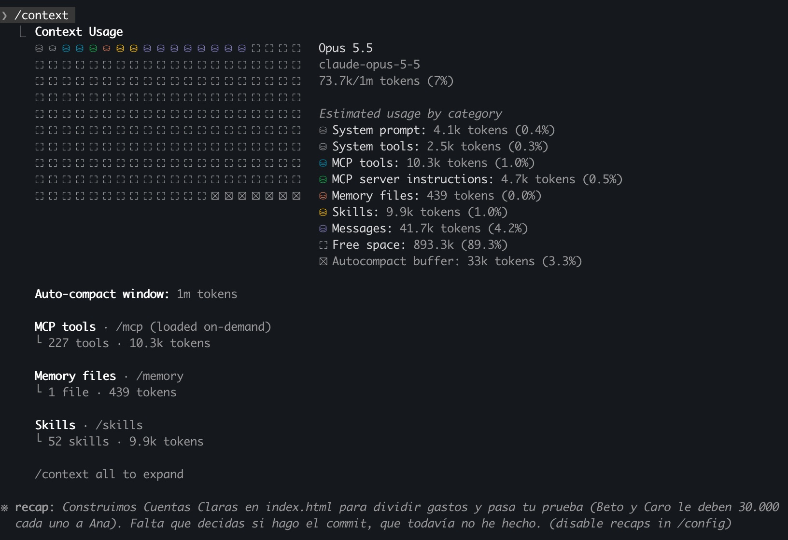

[Inicio](../../) · **Sesiones con Claudio · Sesión 1**

# Sesión 1 · Desarma una app. Construye la tuya.

Hoy aprendes a trabajar con **Claude Code**, el agente de Claude que vive en tu terminal. Primero
desarmamos una app real de dividir gastos para entender cómo está hecha, y después construimos la
nuestra. Todo con un mismo método de cuatro pasos: **explorar → planear → codificar → commit**.

> 🤖 **¿Por qué "Claudio"?** Así le decimos de cariño a Claude en esta serie de tres sesiones. Su nombre completo es **Claudio Tókenez**, porque vive de los tokens (y aquí aprendemos a cuidárselos).
> Cuando leas *Claudio*, hablamos de Claude. Ojo: en la terminal, en los comandos y en la app se
> sigue escribiendo `claude`.

> ▶ **Video:** próximamente.
>
> 📝 **Pad de la clase:** [pad.riseup.net/p/vibe-coding-sesiones-con-claudio-29-oct](https://pad.riseup.net/p/vibe-coding-sesiones-con-claudio-29-oct). Escribe tu nombre en cada check-in y marca tu estado.

## Contenido

1. [Antes de empezar](#antes)
2. [Las cuatro victorias de hoy](#victorias)
3. [Qué es Claude Code](#que-es)
4. [Parte 0 · Instala Claude Code](#parte-0)
   - [Paso 1. Instálalo desde la terminal](#paso-1)
   - [Paso 2. Primer arranque](#paso-2)
   - [Paso 3. Los modos de permiso](#paso-3)
5. [Parte 1 · Explorar: desarma Spliit](#parte-1)
   - [Paso 4. Clona Spliit y ábrelo en modo plan](#paso-4)
   - [Paso 5. Pregúntale a Spliit cómo funciona](#paso-5)
6. [La mesa de trabajo (ventana de contexto)](#mesa)
7. [Parte 2 · Planear](#parte-2)
   - [Paso 6. Una carpeta nueva para tu app](#paso-6)
   - [Paso 7. Pídele un plan](#paso-7)
8. [Parte 3 · Codificar](#parte-3)
   - [Paso 8. Aprueba el plan y míralo construir](#paso-8)
   - [Paso 9. Que Claudio la pruebe en Chrome](#paso-9)
   - [La mesa después de construir (Claudio Tókenez)](#mesa-2)
9. [Parte 4 · Commit y GitHub](#parte-4)
   - [Paso 10. Revisión y commit](#paso-10)
   - [Paso 11. Conecta Claudio con tu GitHub](#paso-11)
   - [Paso 12. Sube tu app a GitHub](#paso-12)
10. [Taller](#taller)
11. [Problemas frecuentes](#problemas)
12. [Glosario](#glosario)

<a id="antes"></a>

## Antes de empezar

- [ ] **Una cuenta de Claude Pro** (o Max). Con el plan gratis, Claude Code no funciona. ¿No tienes Pro? Mira la [nota de la Claude Console](#sin-pro).
- [ ] **Git.** En Mac ya viene (si al usarlo te pide instalar las herramientas de desarrollo, acepta). En Windows, instala [Git for Windows](https://git-scm.com/downloads/win) con las opciones que trae.
- [ ] **Google Chrome** (o Edge, Brave, Arc) con la extensión [Claude in Chrome](https://chromewebstore.google.com/detail/claude/fcoeoabgfenejglbffodgkkbkcdhcgfn), iniciada con la misma cuenta de Claude. La usas en el [paso 9](#paso-9).
- [ ] Si puedes, instala Claude Code antes de la clase con el [paso 1](#paso-1).

<a id="victorias"></a>

## Las cuatro victorias de hoy

1. **Victoria 1:** Spliit en tu computador y Claude Code abierto en modo plan.
2. **Victoria 2:** Claude te explica cómo Spliit calcula quién le debe a quién.
3. **Victoria 3:** Claudio prueba tu app en Chrome y la app dice quién debe cuánto.
4. **Victoria 4:** tu primer commit, hecho con Claudio, aparece en tu repositorio de GitHub.

Vamos de a una. Lo que no se explica hoy, funciona igual: **confía en la magia**.

En el [pad de la clase](https://pad.riseup.net/p/vibe-coding-sesiones-con-claudio-29-oct) escribe tu nombre debajo de cada check-in y marca tu estado:

- ✅ **Hecho:** ya lo ves en tu pantalla.
- 🙋 **Duda:** te trabaste. Escribe en qué paso, así te ayudamos.

<a id="que-es"></a>

## Qué es Claude Code

Claude Code es un **agente**: un asistente que no solo te responde, sino que actúa. Usa
herramientas, mira el resultado y vuelve a intentar hasta lograr lo que le pediste. Funciona en un
ciclo: tú le pides algo, reúne el contexto que necesita, actúa, verifica, y si no quedó bien, vuelve
a empezar. Lo puedes interrumpir en cualquier momento con **Esc**.

Con Claude Code puedes:

- **Leer y entender un proyecto:** que te explique cómo funciona algo o dónde está un error.
- **Editar archivos:** crear y cambiar los archivos de tu carpeta.
- **Correr comandos:** instalar cosas, ejecutar herramientas y decidir qué hacer con lo que respondan.
- **Buscar en la web:** documentación o la versión más nueva de una herramienta.

**¿En qué se diferencia de lo que ya conoces?**

| | Chat de Claude | Antigravity | Claude Code |
|---|---|---|---|
| Qué es | Un chat | Un editor de código con agentes | Un agente en la terminal |
| Qué ve | Lo que le pegas o subes | La carpeta abierta | La carpeta donde lo abres |
| Ves el código | Solo el que te muestra | Siempre, en el editor | Solo los cambios que hace |
| Mejor para | Pensar y preguntar | Ver el código mientras el agente trabaja | Delegarle tareas enteras |

Antigravity es como tener al agente sentado a tu lado. Con Claude Code, le das la llave de tu
carpeta y te va mostrando lo que hace. Claude Code también existe como extensión de VS Code, como
app de escritorio y en la web; en este ciclo lo usamos en la terminal.

<a id="parte-0"></a>

## Parte 0 · Instala Claude Code

<a id="paso-1"></a>

### Paso 1. Instálalo desde la terminal

Abre la terminal de tu sistema, pega el comando y presiona Enter. El instalador no muestra avance
mientras descarga: espera a que termine.

| | Cómo abrir la terminal | Comando |
|---|---|---|
| **Mac** | Cmd+Espacio, escribe "Terminal" | `curl -fsSL https://claude.ai/install.sh \| bash` |
| **Linux** | Ctrl+Alt+T (Ubuntu) | `curl -fsSL https://claude.ai/install.sh \| bash` |
| **Windows** | Tecla Windows, escribe "PowerShell" | `irm https://claude.ai/install.ps1 \| iex` |

En Windows también puedes usar CMD:
`curl -fsSL https://claude.ai/install.cmd -o install.cmd && install.cmd && del install.cmd`

<a id="paso-2"></a>

### Paso 2. Primer arranque

1. **Cierra la terminal y abre una nueva.** Si no, te dirá que no encuentra `claude`.
2. Verifica la instalación:
   ```
   claude --version
   ```
   Debe responder con un número de versión.
3. Escribe `claude` y presiona Enter. La primera vez te pide escoger colores y **entrar con tu cuenta de Claude** (se abre el navegador).

<a id="sin-pro"></a>

> **¿No tienes Claude Pro?** Claude Code también funciona con una cuenta de la
> [Claude Console](https://platform.claude.com), que se paga por uso. Al entrar, escoge
> "Anthropic Console" en vez de tu cuenta de claude.ai. Antes de empezar, ponle un **límite de
> gasto** en la Console: cada pregunta cuesta.

<a id="paso-3"></a>

### Paso 3. Los modos de permiso

Claude Code te deja escoger cuánta libertad le das. Cambias de modo con **Shift+Tab**, y el modo
activo se ve abajo en la terminal.

| Modo | Qué hace Claude | Cuándo usarlo |
|---|---|---|
| **Manual** | Te pide permiso antes de cambiar un archivo o correr un comando | Cuando empiezas o algo es delicado |
| **Auto-aceptar** | Edita archivos sin preguntar; los demás comandos sí los pregunta | Cuando ya aprobaste el plan y quieres velocidad |
| **Plan** | Solo lee y explora, no cambia nada. Al final te propone un plan | Para investigar o antes de construir |
| **Auto** | Trabaja sin preguntar; un revisor automático bloquea lo peligroso | Cuando ya confías en el flujo (lo vemos en la sesión 2) |

La regla: **plan para pensar, auto-aceptar para construir, manual cuando no estás seguro.**
Entre menos te pregunta, más fácil se le pasa un error sin que lo veas.

<a id="parte-1"></a>

## Parte 1 · Explorar: desarma Spliit

[Splitwise](https://www.splitwise.com) es una app para dividir gastos entre amigos, y cobra por
varias de sus funciones. **[Spliit](https://spliit.app/)** es una alternativa de **código abierto** (licencia MIT): su
código es público y se puede leer, estudiar y usar para aprender. Por eso desarmamos Spliit y no
Splitwise: **antes de desarmar una app, mira su licencia.**

Antes de desarmarla, úsala un minuto: entra a [spliit.app](https://spliit.app/), crea un grupo de
prueba y registra un gasto. Así sabes qué buscar cuando la abras por dentro.

<a id="paso-4"></a>

### Paso 4. Clona Spliit y ábrelo en modo plan

**Clonar** es bajar a tu computador una copia completa del código de un proyecto de GitHub. En la
terminal (fuera de Claude Code):

```
mkdir claudio && cd claudio
git clone https://github.com/spliit-app/spliit.git
cd spliit
```

Ahora abre Claude Code **en modo plan**, para que solo pueda mirar y no cambie nada:

```
claude --permission-mode plan
```

✅ **Victoria 1** cuando veas el modo plan activo abajo en la terminal, dentro de la carpeta `spliit`.

<a id="paso-5"></a>

### Paso 5. Pregúntale a Spliit cómo funciona

No tienes que leer el código: Claudio lo lee por ti. Pega este prompt:

> Explícame como si no supiera programar: ¿qué pantallas tiene esta app y qué guarda? Si das ejemplos con dinero, usa pesos colombianos (COP) con montos en miles, como 30.000 o 90.000, aunque el código y la documentación usen euros.

Cuando responda, pega este:

> ¿Cómo calcula esta app quién le debe a quién? ¿Qué formas de dividir un gasto tiene? Explica cada forma con un ejemplo de tres amigos y montos en pesos colombianos (miles de pesos, como 120.000 de un mercado). Muéstrame los archivos y las líneas.

Mientras trabaja, fíjate en lo que hace: **no lee todo el proyecto**. Busca, abre solo los archivos
que necesita y te dice de dónde sacó cada respuesta.

✅ **Victoria 2** cuando Claude te explique quién le debe a quién. ¿Cuántas formas de dividir encontró?

<a id="mesa"></a>

## La mesa de trabajo (ventana de contexto)

Escribe esto en Claude Code:

```
/context
```

Te muestra cuánto se ha llenado su **ventana de contexto**. Piénsala como la mesa de trabajo de
Claude: todo lo que lee queda encima (tus mensajes, los archivos, lo que responde cada comando). La
mesa es grande, pero no infinita. Cuando se llena, Claude resume lo de abajo para hacer espacio, y en
el resumen se pierden detalles. Por eso:

1. **Una tarea, una sesión.** Desarmar Spliit y construir tu app son dos tareas: la siguiente parte empieza en una sesión nueva.
2. **Pregunta concreto.** "Analiza todo" llena la mesa; "¿cómo calcula quién debe a quién?" trae solo lo necesario.
3. **Mira la mesa** con `/context` de vez en cuando.

Sal de Claude Code con `/exit`.

<a id="parte-2"></a>

## Parte 2 · Planear

<a id="paso-6"></a>

### Paso 6. Una carpeta nueva para tu app

Sal de la carpeta `spliit` y crea la de tu app al lado:

```
cd ..
mkdir mi-splitwise && cd mi-splitwise
git init
claude --chrome
```

El `--chrome` conecta a Claudio con tu navegador; lo usas en el [paso 9](#paso-9). La primera vez
te muestra un aviso sobre la extensión: presiona Enter.

<a id="paso-7"></a>

### Paso 7. Pídele un plan

Presiona **Shift+Tab** hasta que veas el modo plan abajo. Pega este prompt:

> Quiero una app de dividir gastos entre amigos, en un solo archivo index.html, inspirada en lo que aprendimos de Spliit. Debe permitir: agregar personas, registrar un gasto (quién pagó, cuánto, entre quiénes, en partes iguales) y mostrar quién le debe a quién con la menor cantidad de pagos. Guarda los datos en el navegador y que se vea bien en el celular. No uses el nombre ni el logo de Splitwise ni de Spliit. Sabremos que funciona si: con Ana, Beto y Caro, Ana paga 90.000 de una cena entre los tres, y la app dice que Beto y Caro le deben 30.000 cada uno a Ana. Antes de escribir código, hazme las preguntas que necesites.

Fíjate en lo que tiene un buen prompt: **qué quieres, qué debe hacer, cómo sabremos que funciona**
y una invitación a que te pregunte. Responde sus preguntas y **lee el plan**: es el mejor momento
para corregir, porque todavía no existe el código. Si algo no te convence, pídele que lo cambie
antes de aprobar.

#### Hazla tuya

Ana, Beto y Caro son el ejemplo de base, como en la documentación de Spliit. Pero tu app será más
útil si resuelve algo de tu vida. Piensa en para quién la harías y cambia en el prompt **quiénes
son, qué gastos tienen y tu criterio de éxito**. Algunas ideas:

- **Las cuentas con tu pareja:** arriendo, mercado y servicios del mes. *Criterio:* si tú pagas el mercado de 300.000 y tu pareja paga los servicios de 200.000, la app dice que tu pareja te debe 50.000.
- **Un viaje con tu grupo de amigos:** alojamiento, transporte y comidas, cada uno pagado por alguien distinto. *Criterio:* si son cinco y uno paga la finca de 1.500.000, cada uno de los otros cuatro le debe 300.000.
- **Una empresa que alquila un espacio compartido:** los socios pagan en proporción a su participación. Aquí no se divide en partes iguales, sino **por porcentaje** (como uno de los modos de Spliit): cámbialo en el prompt. *Criterio:* si el arriendo es de 2.000.000 y los socios tienen 50 %, 30 % y 20 %, la app dice que les toca 1.000.000, 600.000 y 400.000.

**El ejemplo del profe:** Juan David va a construir la app para el viaje de fin de año con su
familia. Así quedó su prompt:

> Quiero una app para llevar las cuentas del viaje de fin de año de mi familia, en un solo archivo index.html, inspirada en lo que aprendimos de Spliit. Somos cuatro: Papá, Mamá, Ricardo y Juan David. Debe permitir registrar un gasto (quién pagó, cuánto, entre quiénes, en partes iguales), ver la lista de gastos del viaje y mostrar quién le debe a quién con la menor cantidad de pagos. Usa pesos colombianos. Guarda los datos en el navegador y que se vea bien en el celular. No uses el nombre ni el logo de Splitwise ni de Spliit. Sabremos que funciona si: Papá paga el alojamiento de 1.200.000 entre los cuatro, y la app dice que Mamá, Ricardo y Juan David le deben 300.000 cada uno a Papá. Antes de escribir código, hazme las preguntas que necesites.

<a id="parte-3"></a>

## Parte 3 · Codificar

<a id="paso-8"></a>

### Paso 8. Aprueba el plan y míralo construir

Cuando el plan te guste, apruébalo escogiendo **auto-aceptar ediciones**: Claude construye sin
pedirte permiso archivo por archivo. Si ves que se desvía, presiona **Esc** y corrígelo.

<a id="paso-9"></a>

### Paso 9. Que Claudio la pruebe en Chrome

Aquí se ve el ciclo del agente completo: Claudio no solo construye, también **verifica**. Con la
extensión de Chrome abre tu app, la usa como lo haría una persona y revisa si cumple tu criterio de
éxito. Pega este prompt (cambia el criterio por el tuyo):

> Abre mi app en Chrome y pruébala como lo haría una persona: agrega a Ana, Beto y Caro, registra que Ana pagó 90.000 de una cena entre los tres y revisa si la app dice que Beto y Caro le deben 30.000 cada uno a Ana. Si algo no cumple, corrígelo y vuelve a probar hasta que funcione. Al final dime qué probaste y qué corregiste.

Vas a ver a Claudio trabajar en una pestaña de Chrome: hace clic, escribe y lee los resultados.
Cuando te pida permiso para usar el navegador ("Claude in Chrome wants to…"), apruébalo.

Después pruébala **tú también**, con tus propios datos. **Claude se equivoca:** puede entenderte
mal, meter errores o hacer cosas que no pediste, y también puede probar mal. Si algo falla, díselo
con un ejemplo concreto y pide los ajustes de a uno.

¿No funciona la extensión? Abre la app tú y pruébala a mano:

- **Mac:** `open index.html`
- **Windows:** `start index.html`
- **Linux:** `xdg-open index.html`

✅ **Victoria 3** cuando Claudio (y tú) registren un gasto y la app diga quién debe cuánto.

<a id="mesa-2"></a>

### La mesa después de construir (Claudio Tókenez)

Ya construiste una app entera. Antes del commit, escribe otra vez:

```
/context
```

Así se veía la mesa del profe en este mismo punto:



**Cómo leerla:**

| Lo que dice | Qué significa |
|---|---|
| **73.7k / 1M tokens (7 %)** | La mesa es enorme: después de construir una app completa, apenas va un 7 %. |
| **System prompt** y **System tools** | Lo que Claudio trae de fábrica: sus instrucciones y sus herramientas básicas (leer, editar, correr comandos). |
| **MCP tools** (227 herramientas) | Lo que el profe le ha conectado (correo, Notion, Chrome…). Ocupan espacio aunque no las use hoy. |
| **Skills** (52) | Habilidades guardadas. Ocupan poco: de cada una, Claudio solo carga el nombre y la descripción hasta que la necesita. Lo vemos en la sesión 3. |
| **Messages** | La conversación y todo lo que Claudio leyó y respondió para construir la app. **Este es el trabajo de verdad.** |
| **Autocompact buffer** | Espacio que Claudio deja libre para resumir cuando la mesa se llene. |

Fíjate también en el **recap** de abajo: Claudio le puso nombre a la app ("Cuentas Claras") y resumió
en qué vamos. Puede hacerlo porque todo está sobre la mesa.

**Para conversar:**

1. **Compara tu mesa con la del profe.** La tuya seguramente tiene menos cosas antes de empezar, porque no tienes herramientas conectadas ni skills. Es como la maleta de un viaje: el profe empacó 227 herramientas "por si acaso" y viajan con él aunque no las saque.
2. **¿Cuánto es un millón de tokens?** Un token es más o menos un pedazo de palabra. En esa mesa cabe *Cien años de soledad* unas cuatro veces. Pero ojo: cada vez que le escribes, Claudio **vuelve a mirar toda la mesa**.
3. **Claudio Tókenez vive de tokens.** Tu plan tiene un límite de uso que se renueva cada cierto tiempo, y entre más llena la mesa, más le cuesta cada respuesta. Por eso: una tarea, una sesión (`/clear` antes de la siguiente idea), preguntas concretas, y conectar solo lo que usas.
4. **El modelo también cuenta.** Arriba dice qué modelo estás usando. Los más potentes gastan el límite más rápido; en la sesión 2 aprendemos a escoger con `/model`.

> El tamaño de tu mesa puede ser distinto al del profe: depende del modelo y del plan.

En el [pad](https://pad.riseup.net/p/vibe-coding-sesiones-con-claudio-29-oct) escribe: tu nombre · el % que te salió · qué categoría ocupa más.

<a id="parte-4"></a>

## Parte 4 · Commit y GitHub

Hasta ahora tu app vive solo en tu computador. En esta parte la guardas (commit) y la subes a
GitHub (push), para que quede respaldada en internet y la puedas publicar en la sesión 2.

Dos palabras que vas a ver mucho:

- **Commit:** una foto de tu proyecto, guardada **en tu computador**, a la que siempre puedes volver.
- **Push:** subir tus commits a tu **repositorio remoto** en GitHub. El remoto es la copia de tu proyecto que vive en internet.

En el Nivelatorio esto lo hacía Antigravity con botones. Aquí se lo pides a Claudio en palabras,
y él corre los comandos de `git` por ti.

<a id="paso-10"></a>

### Paso 10. Revisión y commit

1. **Pruébala tú** con un caso propio (por ejemplo, un gasto entre cuatro personas).
2. Presiona **Shift+Tab** hasta volver a **modo manual**. Subir cosas a internet es delicado: así Claudio te pide permiso antes de cada comando.
3. Pega este prompt:

> Revisa con ojos frescos lo que hicimos, como si no lo hubieras escrito tú: ¿hay errores en las cuentas o casos que se rompan? Si todo está bien, haz el commit con un mensaje en español que explique qué hace la app. Si git no sabe mi nombre y mi correo, pregúntamelos y configúralos antes del commit.

4. Si es tu primer commit en este computador, Claudio te va a preguntar tu nombre y tu correo: usa **el mismo correo de tu cuenta de GitHub**. Lee cada comando que te propone y apruébalo.
5. Comprueba la foto:

```
! git log --oneline
```

El `!` al principio corre el comando directamente, sin salir de Claude Code. Debes ver una línea
con el mensaje de tu commit.

<a id="paso-11"></a>

### Paso 11. Conecta Claudio con tu GitHub

Para subir cosas a tu GitHub, tu computador necesita permiso de tu cuenta. Lo más fácil es
**GitHub CLI** (`gh`), la herramienta oficial de GitHub para la terminal. Solo se hace una vez por
computador.

**1. Instala `gh`.** Abre otra terminal (deja Claude Code abierto) y usa el comando de tu sistema:

| Sistema | Comando |
|---|---|
| **Mac** (con Homebrew) | `brew install gh` |
| **Windows** | `winget install --id GitHub.cli` |
| **Mac sin Homebrew o Linux** | Descarga el instalador de [cli.github.com](https://cli.github.com) |

Cierra esa terminal cuando termine.

**2. Inicia sesión.** De vuelta en Claude Code, escribe:

```
! gh auth login
```

Este paso lo haces **tú**, no Claudio: es tu cuenta. Responde así a las preguntas (con las flechas y Enter):

1. Where do you use GitHub? → **GitHub.com**
2. Preferred protocol → **HTTPS**
3. Authenticate Git with your GitHub credentials? → **Yes**
4. How would you like to authenticate? → **Login with a web browser**
5. Copia el código de 8 caracteres que aparece, presiona Enter, pégalo en la página que se abre y autoriza.

Comprueba que quedó:

```
! gh auth status
```

Debe decir `Logged in to github.com account` con tu usuario.

<a id="paso-12"></a>

### Paso 12. Sube tu app a GitHub

Pega este prompt:

> Crea un repositorio en mi GitHub llamado mi-splitwise, conéctalo como remoto de esta carpeta y sube mi commit. Usa gh. Antes de crearlo, dime si va a ser público o privado y espera mi respuesta.

Lo más probable es que Claudio te proponga algo como esto:

```
gh repo create mi-splitwise --public --source=. --remote=origin --push
```

Así se lee: crea el repositorio `mi-splitwise` en tu GitHub (público), toma esta carpeta como su
contenido, llama `origin` al remoto y sube (`push`) tus commits. Apruébalo.

**¿Público o privado?** Si es público, cualquiera puede ver el código (no los gastos: esos se
guardan solo en tu navegador). Para publicar la app gratis con GitHub Pages en la sesión 2 conviene
que sea público. Antes de aprobar, revisa que en el código no haya datos que no quieras mostrar.

Para verla en internet:

```
! gh repo view --web
```

✅ **Victoria 4** cuando veas tu `index.html` y tu commit en GitHub.

**De aquí en adelante**, cada vez que hagas un cambio, el ciclo es corto: pídele a Claudio
*"haz commit de estos cambios con un buen mensaje y súbelos a GitHub"*. Él hace el commit y el
`git push`.

<a id="taller"></a>

## Taller

1. **Divide por porcentajes**, como Spliit. Usa el mismo método: plan primero, después código, después commit.
2. **Memoria entre sesiones:** escribe `/init` en Claude Code (crea un archivo `CLAUDE.md` con lo que sabe de tu proyecto). Cierra Claude Code, ábrelo otra vez y pídele una mejora. ¿Se acordó de tu app sin explicarle?
3. **Reto:** que los gastos se compartan entre varios teléfonos. Pista: necesitas una base de datos, como la de la [sesión 3 del Nivelatorio](../../sesiones/03/).

<a id="problemas"></a>

## Problemas frecuentes

| Problema | Solución |
|---|---|
| `command not found: claude` o "no se reconoce" | Cierra la terminal y abre una nueva. Si sigue, repite el [paso 1](#paso-1). |
| Windows: `'irm' is not recognized` | Estás en CMD, no en PowerShell. Usa el comando de CMD del [paso 1](#paso-1). |
| Windows: `The token '&&' is not a valid statement separator` | Estás en PowerShell. Usa el comando de PowerShell. |
| `git: command not found` o "git no se reconoce" | Falta Git. En Windows instala [Git for Windows](https://git-scm.com/downloads/win); en Mac acepta instalar las herramientas de desarrollo. Cierra y abre la terminal. |
| Claude Code dice que tu plan no incluye Claude Code | Estás con el plan gratis. Necesitas Pro, Max o una [cuenta de la Console](#sin-pro). |
| No ves el modo plan | Presiona Shift+Tab hasta que aparezca abajo, o cierra con `/exit` y abre otra vez con `claude --permission-mode plan`. |
| Claudio dice "Browser extension is not connected" o "No browsers are connected" | Abre Chrome y revisa que la extensión esté iniciada con **la misma cuenta** de Claude. En Claude Code escribe `/chrome` y escoge "Reconnect extension". Si es la primera vez, cierra y abre Chrome. |
| Claudio no puede abrir `index.html` en Chrome | En Chrome ve a `chrome://extensions`, abre los **Detalles** de la extensión de Claude y activa **Permitir acceso a las URL de archivos**. |
| Entraste con la Claude Console (API) y no hay Chrome | La extensión solo funciona con cuentas Pro, Max, Team o Enterprise. Prueba la app a mano (paso 9). |
| `Author identity unknown` o "please tell me who you are" | Git no sabe tu nombre. Pídele a Claudio: "configura mi nombre y correo de git" y dale los datos de tu cuenta de GitHub. |
| `gh: command not found` | Cierra la terminal y abre una nueva después de instalar `gh`. Si sigue, repite la instalación del [paso 11](#paso-11). |
| `Permission denied` o `403` al subir | `gh` no tiene permiso o entraste con otra cuenta. Corre `! gh auth status` y, si hace falta, `! gh auth login` otra vez. |
| `repository already exists` | Ya tienes un repositorio con ese nombre en GitHub. Pídele a Claudio que use otro nombre, como `mi-splitwise-2`. |
| La app no hace bien las cuentas | Dale a Claude el caso exacto que falla ("con estos gastos dice X y debería decir Y"). |

<a id="glosario"></a>

## Glosario

- **Agente:** un asistente de IA que actúa (usa herramientas, cambia archivos, corre comandos) para lograr una meta, y verifica su trabajo.
- **Claude Code:** el agente de Claude que trabaja dentro de una carpeta de tu computador.
- **Terminal:** la ventana donde le das instrucciones al computador escribiendo comandos.
- **Modo plan:** el modo en que Claude solo mira y propone; no cambia nada.
- **Auto-aceptar:** el modo en que Claude edita archivos sin pedirte permiso cada vez.
- **Ventana de contexto:** la "mesa de trabajo" de Claude: todo lo que puede tener presente a la vez.
- **Clonar:** bajar a tu computador una copia completa de un proyecto de GitHub.
- **Código abierto:** software cuyo código es público y se puede estudiar y reutilizar según su licencia.
- **Claude in Chrome:** la extensión que deja a Claudio usar tu navegador para probar lo que construye.
- **Commit:** una foto guardada de tu proyecto, con un mensaje que dice qué cambió.
- **Push:** subir tus commits al repositorio remoto.
- **Repositorio remoto:** la copia de tu proyecto que vive en GitHub.
- **GitHub CLI (`gh`):** la herramienta oficial de GitHub para la terminal; con ella Claudio crea repositorios y sube cambios.

---

[Inicio](../../)
