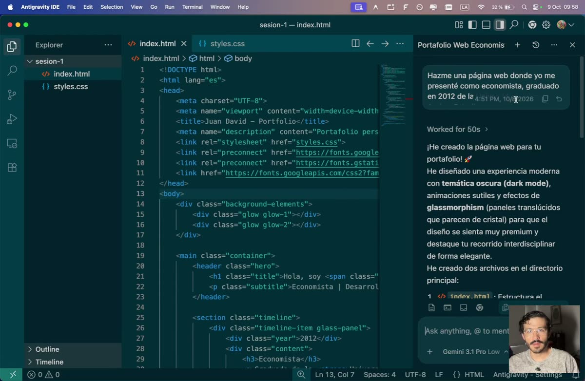
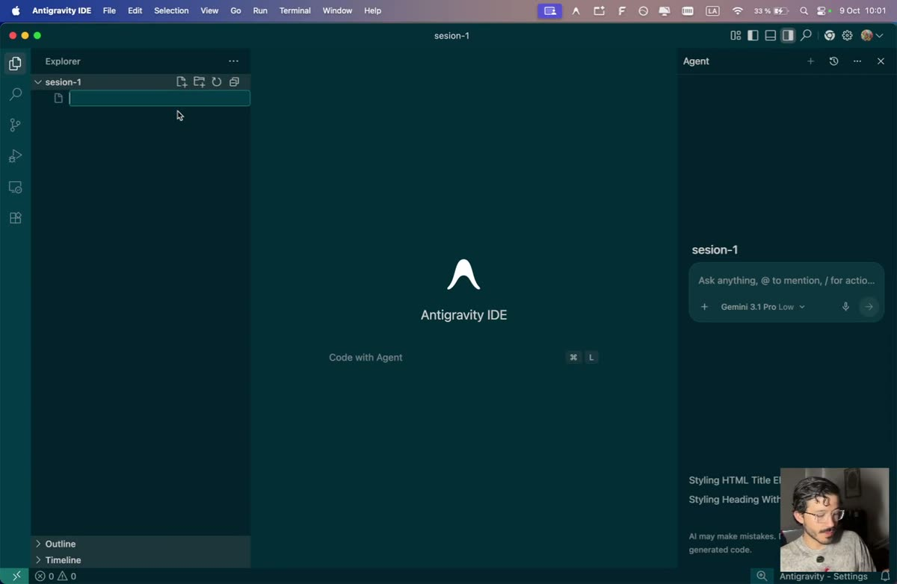
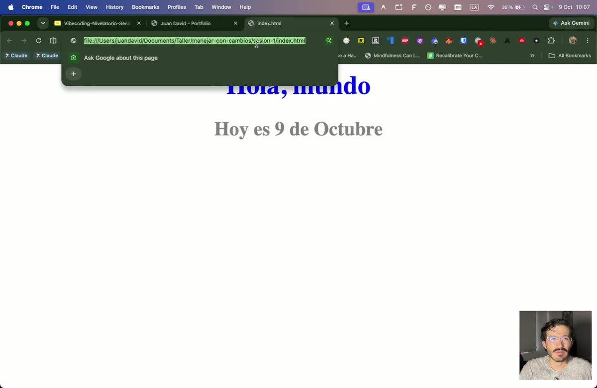
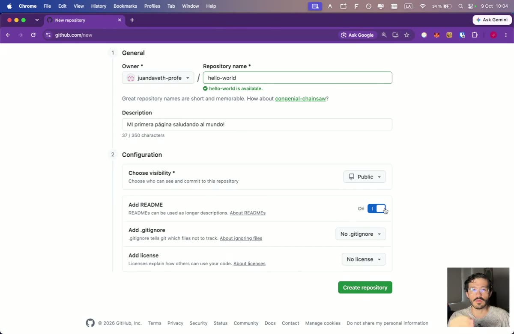
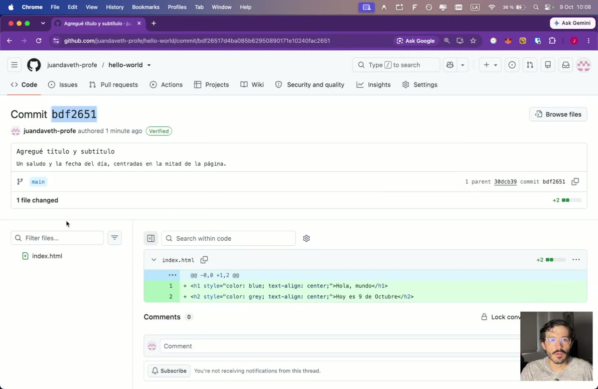
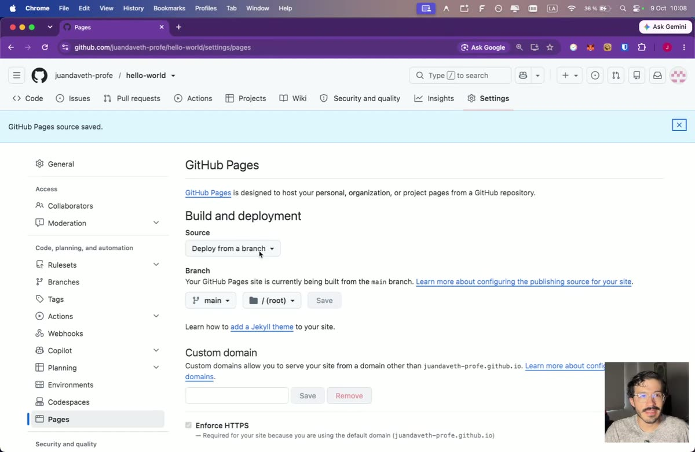
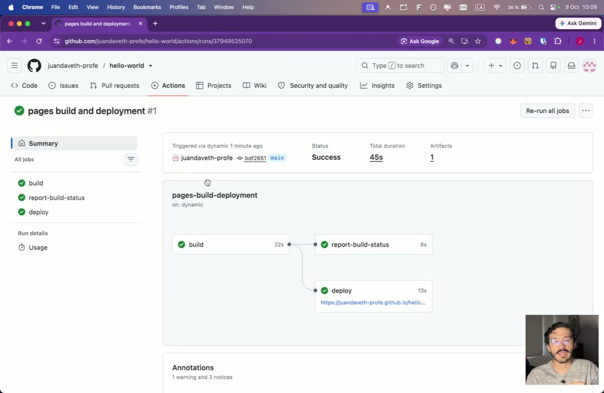
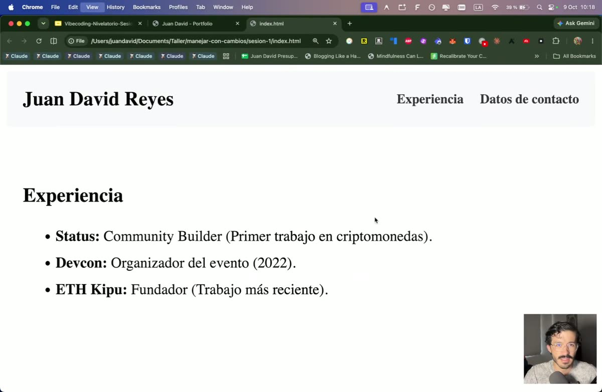
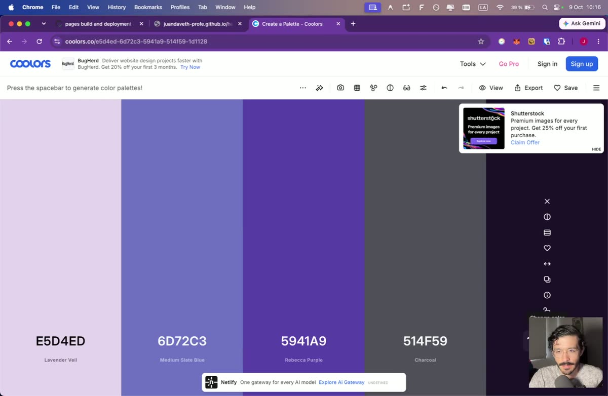
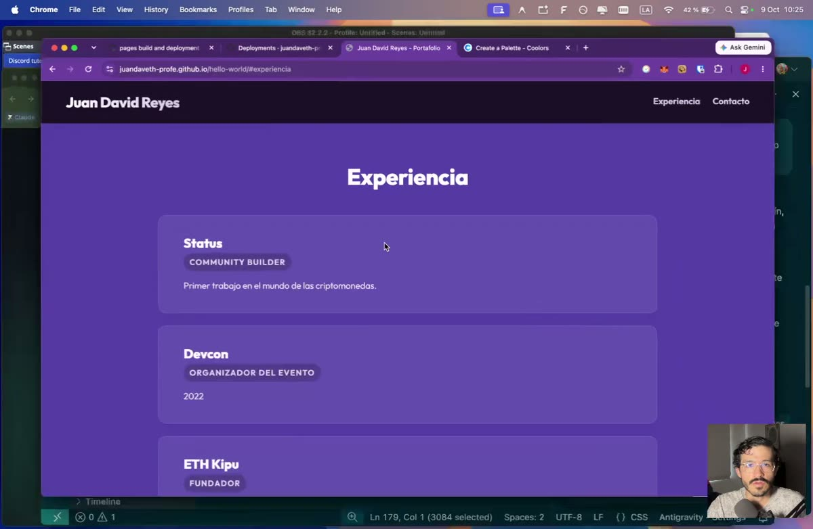

[Inicio](../../) · **Sesión 1** · Sesión 2 (15 oct, próximamente)

# Sesión 1 · Tu primera página web con IA

Al terminar esta guía vas a tener una página web tuya, publicada en internet y con un link que puedes compartir. No necesitas saber programar.

> ▶ **Video completo de la clase:** [Ver en YouTube](https://youtu.be/qUCmcmCVIgk). Cada paso tiene un enlace al minuto exacto.

## Contenido

1. [Antes de empezar](#antes)
2. [La idea de la clase: caja de cambios](#idea)
3. [Tres palabras que vas a usar](#palabras)
4. [Parte 1 · Tu "Hola mundo" en tu computador](#parte-1)
   - [Paso 1. Crea tu carpeta y ábrela en Antigravity](#paso-1)
   - [Paso 2. Crea `index.html`](#paso-2)
   - [Paso 3. Tus primeros cambios con el agente](#paso-3)
5. [Parte 2 · Súbelo a internet](#parte-2)
   - [Paso 4. Crea tu repositorio en GitHub](#paso-4)
   - [Paso 5. Sube `index.html` y haz tu primer commit](#paso-5)
   - [Paso 6. Publica con GitHub Pages](#paso-6)
6. [Repaso](#repaso)
7. [Taller para la sesión 2](#taller)
8. [Problemas frecuentes](#problemas)
9. [Próxima sesión](#proxima)

<a id="antes"></a>

## Antes de empezar

- [ ] Una cuenta en [github.com](https://github.com)
- [ ] [Antigravity](https://antigravity.google) instalado en tu computador

<a id="idea"></a>

## La idea de la clase: caja de cambios, no piloto automático

[▶ 0:10](https://youtu.be/qUCmcmCVIgk?t=10)

Hay dos formas de trabajar con inteligencia artificial:

- **Piloto automático:** le pides "hazme una página web" y la IA toma todas las decisiones. Funciona, pero no entiendes qué hizo ni cómo cambiarlo.
- **Caja de cambios:** le pides cambios pequeños, uno a la vez, y revisas cada uno. Primera, segunda, tercera. Vas más despacio al principio, pero sabes qué estás construyendo.



En este curso manejamos con caja de cambios.

<a id="palabras"></a>

## Tres palabras que vas a usar

[▶ 0:40](https://youtu.be/qUCmcmCVIgk?t=40)

| Palabra | Es como... |
|---|---|
| **Repositorio** | Una carpeta de Google Drive donde viven los archivos de tu proyecto |
| **Commit** | La minuta de una reunión: dice qué cambió y queda con fecha y hora |
| **GitHub Pages** | El servicio que convierte tu carpeta en una página web pública |

---

<a id="parte-1"></a>

## Parte 1 · Tu "Hola mundo" en tu computador

<a id="paso-1"></a>

### Paso 1. Crea tu carpeta y ábrela en Antigravity

[▶ 1:30](https://youtu.be/qUCmcmCVIgk?t=90)

1. Crea una carpeta llamada `sesion-1`.
2. Abre Antigravity y entra al **IDE** (botón arriba a la derecha). El IDE es la pantalla donde ves tu código y lo que la IA cambia.
3. Abre la carpeta `sesion-1`.



En el IDE hay tres zonas:
- **Izquierda, el explorador:** tus archivos y carpetas.
- **Centro, el código.**
- **Derecha, el agente:** el chat con la IA.

<a id="paso-2"></a>

### Paso 2. Crea `index.html`

[▶ 3:03](https://youtu.be/qUCmcmCVIgk?t=183)

1. En el explorador, crea un archivo nuevo llamado exactamente **`index.html`**. Siempre se llama así: es el archivo que los navegadores buscan primero.
2. Escribe en el centro:
   ```
   Hola, mundo
   ```
3. Guarda (`Cmd + S` en Mac, `Ctrl + S` en Windows).
4. Ve a la carpeta y haz doble clic en `index.html`. Se abre en tu navegador.

<a id="paso-3"></a>

### Paso 3. Tus primeros cambios con el agente

[▶ 3:50](https://youtu.be/qUCmcmCVIgk?t=230)

El truco es **seleccionar** el pedazo de código que quieres cambiar y pedirle al agente un cambio pequeño.

1. Selecciona `Hola, mundo` y escríbele al agente:
   ```
   Quiero que sea un título en azul
   ```
2. Cuando proponga el cambio, dale **Aceptar**. Refresca el navegador.
3. Agrega una línea nueva con la fecha de hoy, por ejemplo `Hoy es 8 de octubre`. Selecciónala y pide:
   ```
   Quiero que sea un subtítulo y que esté de color gris
   ```
4. Sin seleccionar nada, pide:
   ```
   Centra ambos elementos
   ```



> **Para entender:** el agente usó `h1` para el título y `h2` para el subtítulo. Son los *headings*: van del `h1` (el más importante) al `h6` (el menos importante).

> **¿No te gustó un cambio?** Usa la flecha de deshacer y vuelve al estado anterior.

---

<a id="parte-2"></a>

## Parte 2 · Súbelo a internet

<a id="paso-4"></a>

### Paso 4. Crea tu repositorio en GitHub

[▶ 5:00](https://youtu.be/qUCmcmCVIgk?t=300)

1. En GitHub, arriba a la derecha: **+ → New repository**.
2. **Repository name:** `hello-world`. Este nombre va a ser parte del link de tu página, así que corto y sin espacios.
3. **Description:** algo como `Mi primera página saludando al mundo`.
4. Activa **Add README**. El README es el manual de instrucciones del proyecto: lo leen las personas (y los agentes) que llegan a tu repositorio.
5. No toques nada más. **Create repository**.



<a id="paso-5"></a>

### Paso 5. Sube `index.html` y haz tu primer commit

[▶ 6:21](https://youtu.be/qUCmcmCVIgk?t=381)

1. En tu repositorio: **Add file → Create new file**.
2. Nómbralo **`index.html`**, igual que en tu computador.
3. En Antigravity, selecciona todo el código de `index.html`, cópialo y pégalo en GitHub.
4. Haz clic en **Commit changes** y escribe la minuta:
   - **Mensaje:** `Agregué título y subtítulo`
   - **Descripción:** `Un saludo y la fecha del día, centrados en la mitad de la página`
5. Deja seleccionada la rama **main** y confirma.



Cada commit tiene un identificador único (en el video, `bdf2651`). Con él puedes decirle a otra persona: "mira el commit bdf2651".

<a id="paso-6"></a>

### Paso 6. Publica con GitHub Pages

[▶ 8:15](https://youtu.be/qUCmcmCVIgk?t=495)

> ⚠️ **Primero sube `index.html` (paso 5) y después activa Pages.** Si lo haces al revés, GitHub publica solo el README y se complica todo.

1. En tu repositorio: **Settings → Pages** (menú de la izquierda).
2. En **Branch**, elige **main** y haz clic en **Save**.



3. Espera entre 1 y 2 minutos. GitHub construye tu página (*build*) y la publica (*deploy*). Lo puedes ver en la pestaña **Actions**: cuando todo tiene ✅, está lista.



4. Tu página queda en:
   ```
   https://TU-USUARIO.github.io/hello-world
   ```

🎉 Ya tienes una página en internet que puedes mandarle a cualquiera.

---

<a id="repaso"></a>

## Repaso

[▶ 11:18](https://youtu.be/qUCmcmCVIgk?t=678)

- **GitHub** guarda tu código en la nube y lleva el historial de cambios. Es como un Drive con historial.
- **Commit** es la minuta: qué cambió y cuándo.
- **Deploy** es publicar: tu página pasa de tu computador a internet.
- **HTML** es el esqueleto de la página y **CSS** es la ropa. Piensa en un maniquí.
- Trabaja de a pedacitos. Un solo prompt grande crea cientos de líneas; si no entiendes lo que se agrega, terminas con *código espagueti*.

---

<a id="taller"></a>

## 🛠 Taller para la sesión 2

[▶ 12:29](https://youtu.be/qUCmcmCVIgk?t=749)

Convierte tu "Hola mundo" en **tu página personal** (o la de tu proyecto) con estas partes:

1. **Encabezado (`nav`):** tu nombre y links a "Experiencia" y "Contacto".
2. **Hero:** la parte grande y destacada de arriba.
3. **Cuerpo:** tu experiencia o de qué trata tu proyecto.
4. **Pie de página (`footer`):** tus datos de contacto.



### Cómo hacerlo, con caja de cambios

**a. La estructura, sección por sección.** Borra el "Hola mundo" y pídele al agente una sección a la vez. Por ejemplo:

```
Quiero que esta primera sección, que es el nav, sea el encabezado de mi página web,
con dos links: uno que lleve a experiencia y otro a datos de contacto.
```

Después selecciona la sección de experiencia y cuéntale tu historia:

```
En esta sección quiero que hagas una lista de los últimos trabajos que he tenido: [tus trabajos].
Organiza esta información en una lista, en orden cronológico.
```

**b. Colores precisos con Coolors** [▶ 16:05](https://youtu.be/qUCmcmCVIgk?t=965)

"Azul clarito" es ambiguo. En [coolors.co](https://coolors.co) oprime la **barra espaciadora** hasta encontrar una paleta que te guste y copia el código del color (por ejemplo `#5941A9`).



```
Quiero que este sea el color del nav: #5941A9
```

**c. Un prompt grande, cuando ya entiendes la estructura** [▶ 17:45](https://youtu.be/qUCmcmCVIgk?t=1065)

```
Me ha gustado la estructura. Quiero ahora aplicarle un diseño profesional
y que se vea muy bien en la pantalla. Utiliza la tecnología mobile first.
```

*Mobile first* significa que la página se diseña primero para el celular y se adapta a pantallas más grandes.



> **Para aprender:** selecciona cualquier pedazo de código que no entiendas y pregúntale al agente "¿qué hace esto en la pantalla?".

**d. Actualiza GitHub** [▶ 21:24](https://youtu.be/qUCmcmCVIgk?t=1284)

1. En tu repositorio abre `index.html`, haz clic en el **lápiz** ✏️, borra todo y pega el código nuevo. Commit con un mensaje que diga qué cambiaste.
2. Si el agente creó un archivo de estilos (por ejemplo `index.css` o `styles.css`), súbelo con **Add file → Create new file**, **con el mismo nombre exacto** que tiene en tu computador. Commit.
3. Revisa en **Actions** que el despliegue termine y abre tu link.

### Entrega

Comparte el link de tu página (`https://TU-USUARIO.github.io/hello-world`) antes de la sesión 2.

---

<a id="problemas"></a>

## Problemas frecuentes

| Lo que pasa | Qué hacer |
|---|---|
| Mi link muestra el README y no mi página | Revisa que el archivo se llame `index.html`, en minúsculas y en la raíz del repositorio. |
| Cambié el código y la página sigue igual | Espera 1 o 2 minutos y mira la pestaña **Actions**. Después refresca con `Cmd + Shift + R`. |
| La página se ve sin colores ni diseño | Falta subir el archivo de estilos, o tiene un nombre distinto al de tu computador. |
| El agente cambió algo que no le pedí | Deshaz el cambio y pídelo de nuevo, seleccionando solo el pedazo que quieres cambiar. |

<a id="proxima"></a>

## Próxima sesión

**Sesión 2 · Dale memoria a tu landing page.** Vas a agregarle a tu página un formulario de contacto: tus visitantes te dejan un mensaje y queda guardado en una base de datos.

---

[↑ Volver al contenido](#contenido) · [← Volver al inicio](../../)
