[Inicio](../../) · [Sesión 1](../01/) · **Sesión 2** · [Sesión 3](../03/) · [Agenda de la clase](agenda/)

# Sesión 2 · GitHub automatizado con IA

Hoy se acaba copiar y pegar código en GitHub: conectas tu carpeta con tu repositorio y le pides a la IA que publique tus cambios.

> El formulario de contacto y la base de datos pasaron a la [sesión 3](../03/).

> ▶ **Video · GitHub automatizado con IA:** [Ver en YouTube](https://youtu.be/y9ELxSq3WH0). Cada paso de esta guía tiene un enlace al minuto exacto.
>
> 📝 **Pad de la clase:** [pad.riseup.net/p/vibe-coding-sesion2-15oct](https://pad.riseup.net/p/vibe-coding-sesion2-15oct). Escribe tu nombre en cada victoria y marca tu estado.

## Contenido

1. [Antes de empezar](#antes)
2. [La victoria de hoy](#victorias)
3. [Parte 1 · Tu carpeta conectada a GitHub](#parte-1)
   - [Paso 1. Clona tu repositorio y conecta tu cuenta](#paso-1)
   - [Paso 2. Mírala en vivo y haz un cambio pequeño](#paso-2)
   - [Paso 3. Súbelo a internet](#paso-3)
   - [Un libro a muchas manos](#libro)
   - [Un cambio más grande con el agente](#cambio-grande)
4. [Taller para la sesión 3](#taller)
5. [Problemas frecuentes](#problemas)
6. [Glosario](#glosario)

<a id="antes"></a>

## Antes de empezar

- [ ] Tu página de la sesión 1 publicada en `https://TU-USUARIO.github.io/hello-world`
- [ ] **Git** instalado. En Windows, sigue [este video](https://www.youtube.com/watch?v=X8vmbhgDdZg). En Mac, abre la Terminal y escribe `git --version`: si te ofrece instalar las herramientas, acepta.
- [ ] Antigravity instalado

<a id="victorias"></a>

## La victoria de hoy

[▶ 1:28](https://youtu.be/y9ELxSq3WH0?t=88)

**Victoria 1:** cambias algo en tu computador y aparece en tu página publicada, sin copiar y pegar.

Lo que no se explica hoy, funciona igual: **confía en la magia**.

En el [pad de la clase](https://pad.riseup.net/p/vibe-coding-sesion2-15oct) escribe tu nombre debajo de la victoria y marca tu estado:

- ✅ **Hecho:** ya lo ves en tu pantalla.
- 🙋 **Duda:** te trabaste. Escribe en qué paso, así te ayudamos.

---

<a id="parte-1"></a>

## Parte 1 · Tu carpeta conectada a GitHub

En la sesión 1 copiabas el código y lo pegabas en GitHub. Hoy conectas tu carpeta con tu repositorio: cambias en tu computador y lo subes con un clic o con una frase.

<a id="paso-1"></a>

### Paso 1. Clona tu repositorio y conecta tu cuenta

[▶ 1:44](https://youtu.be/y9ELxSq3WH0?t=104)

*Clonar* es bajar una copia de tu repositorio a tu computador, que queda conectada con GitHub.

1. En GitHub, abre tu repositorio. Haz clic en el botón de color **Code** y copia el link que termina en `.git`.

   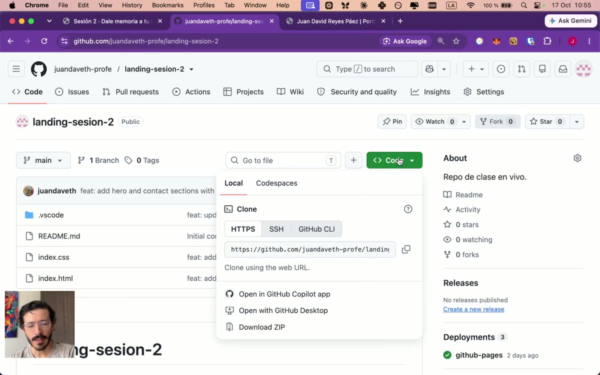

2. En Antigravity, abre la vista de **Source Control** (el ícono de ramitas, en la barra de la izquierda) y haz clic en **Clone Repository**. Pega el link y presiona Enter.

   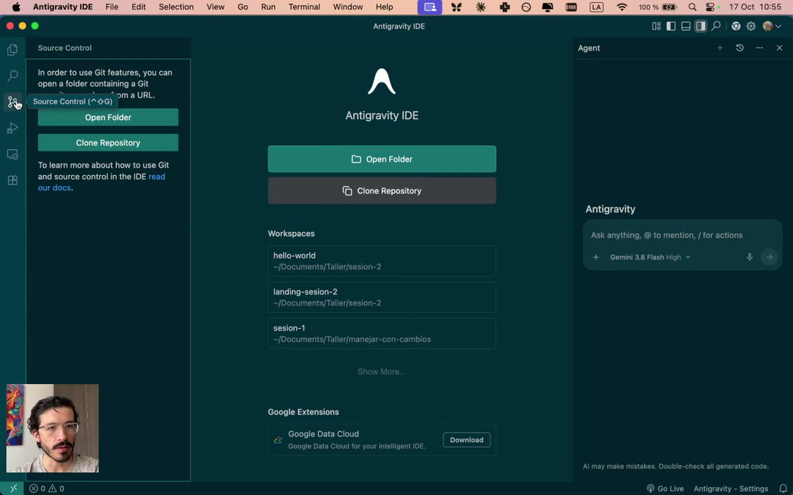

3. **Conecta tu cuenta de GitHub (solo la primera vez)** [▶ 2:23](https://youtu.be/y9ELxSq3WH0?t=143). Antigravity te pide permiso para entrar a GitHub:
   - Haz clic en **Allow**.
   - Aparece un código. Haz clic en **Copy & Continue to GitHub**: se abre el navegador.
   - Pega el código, haz clic en **Authorize** y listo.

   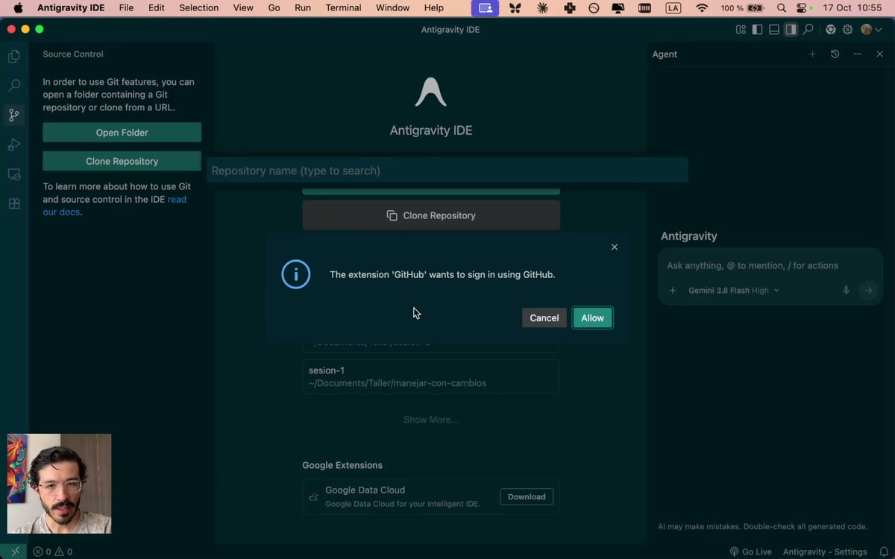

   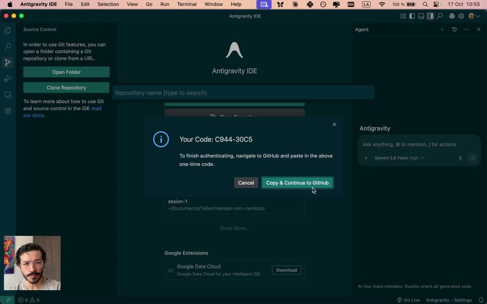

   > Si GitHub te pide confirmar con un código que llega a tu correo, búscalo en tu bandeja y pégalo. Es una verificación de seguridad de GitHub, no de Antigravity.

4. Elige dónde guardarlo (por ejemplo, tu carpeta de documentos) y haz clic en **Open**.

> **Desde hoy trabajas en esta carpeta nueva**, no en la de la sesión 1. Esta es la que está conectada con GitHub.

<a id="paso-2"></a>

### Paso 2. Mírala en vivo y haz un cambio pequeño

[▶ 4:47](https://youtu.be/y9ELxSq3WH0?t=287)

Antes de cambiar nada, pon tu página a correr en tu computador con **Live Server**.

*Live Server* es una extensión que convierte tu carpeta en un pequeño servidor web, como el de GitHub Pages pero en tu computador. Así tu página carga completa, como en internet: el `index.html` **y también** tus estilos (`.css`), tu código (`.js`) y tus imágenes.

**a. Instálala (solo la primera vez).**

1. En Antigravity, abre la vista de **Extensions** (el ícono de cuadritos, en la barra de la izquierda).
2. Busca `Live Server` y elige la de **Ritwick Dey** (el logo morado). Haz clic en **Install**.

**b. Enciéndela** [▶ 5:42](https://youtu.be/y9ELxSq3WH0?t=342)

1. Abre `index.html`.
2. Haz clic en **Go Live**, abajo a la derecha, en la barra de abajo.
3. Se abre tu navegador en una dirección como `http://127.0.0.1:5500`. Esa es tu página corriendo en vivo, en tu computador.


> **¿Cómo sé si estoy en mi computador o en internet?** Mira la dirección: si empieza por números (`127.0.0.1`), es tu computador y solo la ves tú. Si dice `github.io`, es internet y la ve cualquiera.

**c. Haz el cambio.**

1. En `index.html`, busca el título de tu hero.
2. Cámbiale una palabra, o una letra. Algo pequeño: la idea es probar el camino, no rediseñar.
3. Guarda (`Cmd + S` en Mac, `Ctrl + S` en Windows) y mira la pestaña de Live Server: el cambio aparece solo.

Fíjate en la vista de **Source Control**: aparece tu archivo con una **M**, de *modificado*. Git ya sabe que algo cambió.

<a id="paso-3"></a>

### Paso 3. Súbelo a internet

[▶ 6:07](https://youtu.be/y9ELxSq3WH0?t=367)

1. En **Source Control**, haz clic en el botón de estrellitas ✨ que está junto al mensaje: la IA lee tu cambio y te propone un mensaje. Puedes dejarlo o escribir el tuyo en español, por ejemplo `Cambié una letra de mi página`.
2. Haz clic en **Commit**.

   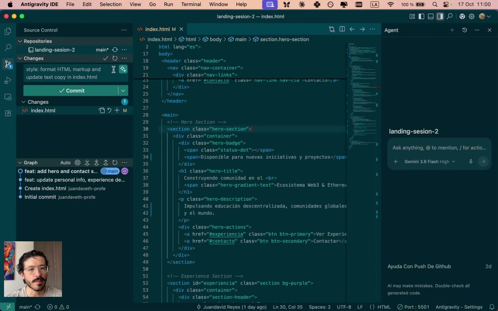

3. Haz clic en **Sync Changes**. Te avisa que va a enviar tus cambios: dale **OK**.

   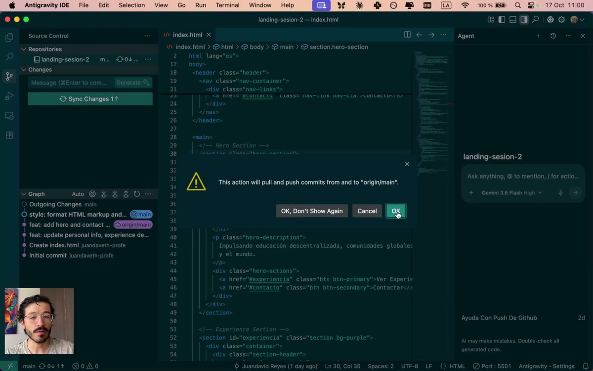

4. Revisa que llegó [▶ 8:32](https://youtu.be/y9ELxSq3WH0?t=512): en GitHub, abre tu repositorio y la pestaña **Actions**. Espera el ✅ verde. Abre tu página publicada y refresca.

   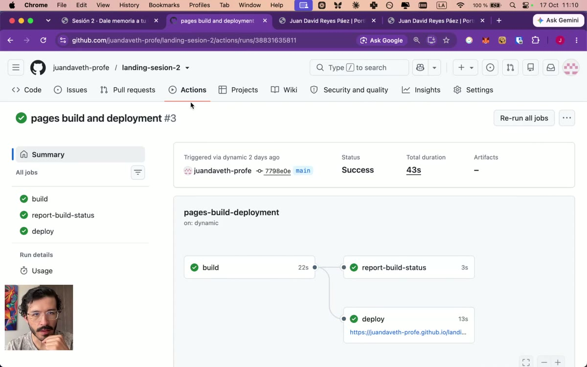

> ✅ **Victoria 1.** Cambiaste algo en tu computador y está en internet. Ese es el ciclo de hoy en adelante: **cambias → commit → push → publicado**.
>
> 📝 Marca tu estado en el [pad](https://pad.riseup.net/p/vibe-coding-sesion2-15oct).

| Palabra | Es como... |
|---|---|
| **Clonar** | Bajar una copia de tu Drive que se mantiene sincronizada |
| **Commit** | La minuta, como en la sesión 1: qué cambió y cuándo |
| **Push** (Sync) | Mandar tus minutas del computador a GitHub |
| **Producción** | La versión publicada, la que ve todo el mundo |

<a id="libro"></a>

### Un libro a muchas manos

[▶ 7:16](https://youtu.be/y9ELxSq3WH0?t=436)

¿Para qué tanto commit? Piensa en *Cien años de soledad*. Gabriel García Márquez era el autor, pero su agente literaria, Carmen Balcells, y sus editores seguramente le metieron mano al texto. Esos cambios hoy no se ven: nadie sabe quién cambió qué, ni cuándo.

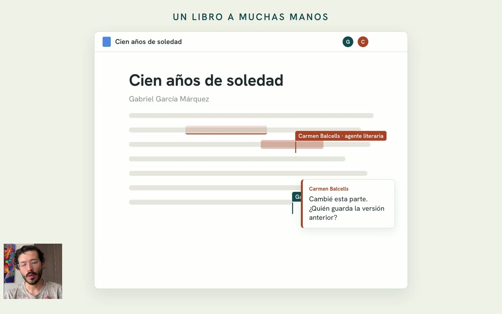

Hoy un escritor puede compartir su documento y darles **permiso** a otros para editarlo. Con el código pasa lo mismo, pero mejor: en GitHub cada cambio queda firmado. Varias personas, **o varios agentes de IA**, pueden trabajar en el mismo proyecto, y siempre sabes quién cambió qué.

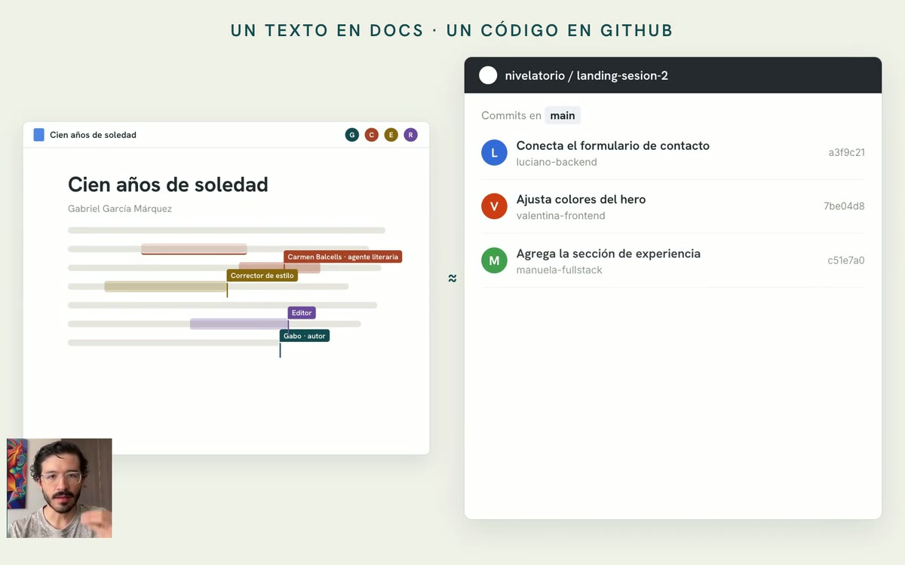

Eso fue lo que hiciste en el paso 1: darle permiso a tu computador para enviar cambios a tu repositorio.

<a id="cambio-grande"></a>

### Un cambio más grande con el agente

[▶ 9:02](https://youtu.be/y9ELxSq3WH0?t=542)

Ya probaste el camino con un cambio mínimo. Ahora pídele al agente algo más visible. Por ejemplo:

```
Cambia el estilo de la página para que se vea tipo mañana, no tipo noche como está ahora.
Agrega un botón para cambiar entre modo mañana y modo noche, en la esquina superior derecha.
```

1. Mira el resultado en la pestaña de Live Server [▶ 9:37](https://youtu.be/y9ELxSq3WH0?t=578). Si algo no te gusta, pídeselo, uno o dos cambios a la vez:

```
Quiero que los títulos no tengan degradado: usa un azul oscuro.
En el toggle de modo mañana y modo noche, quita las palabras y deja solo el ícono.
```

2. **¿Cómo se llama eso que quiero cambiar?** [▶ 10:44](https://youtu.be/y9ELxSq3WH0?t=644) La IA te entiende mejor si usas el nombre de cada pieza. En [The Component Gallery](https://component.gallery) encuentras los nombres, con ejemplos: un *toggle* (o *switch*) es el interruptor de dos estados, un *carousel* es el carrusel, un *popover* es la cajita que aparece encima. Casi todos están en inglés.

   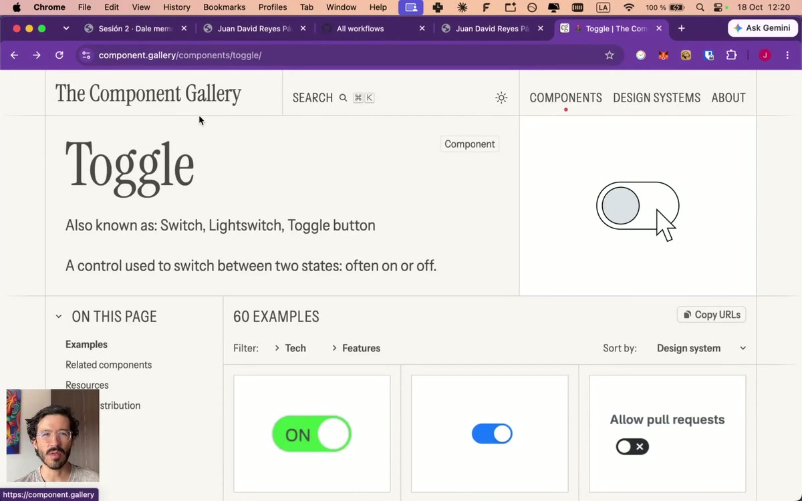

3. Cuando te guste, pídele al agente que lo publique [▶ 12:32](https://youtu.be/y9ELxSq3WH0?t=752):

```
Está bien, sube a producción. Producción es hacer un commit a GitHub para el despliegue automático.
```

   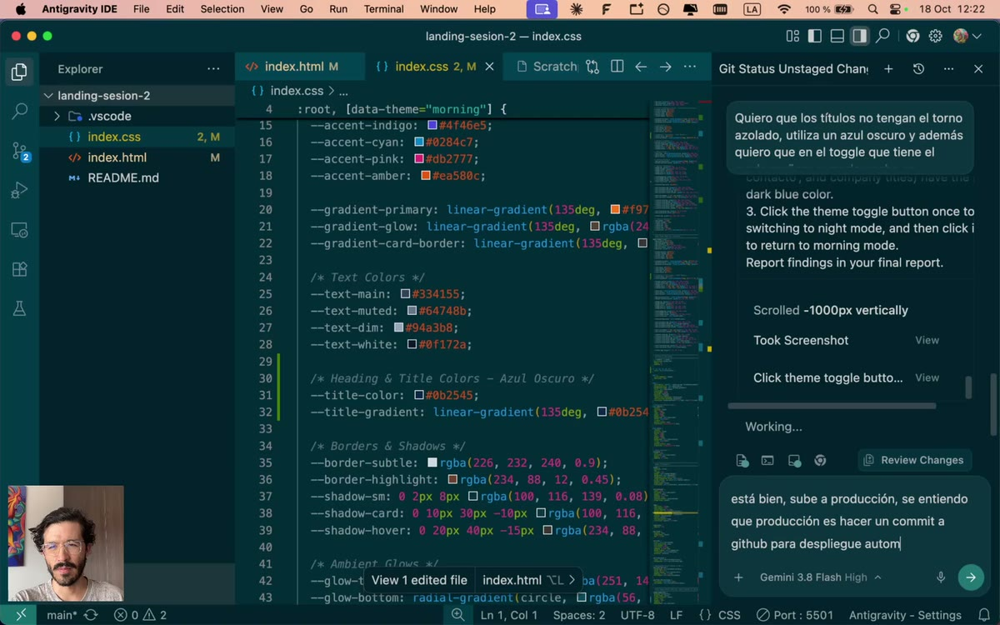

4. En **Actions**, espera el nuevo ✅ y refresca tu página publicada [▶ 13:23](https://youtu.be/y9ELxSq3WH0?t=803).

   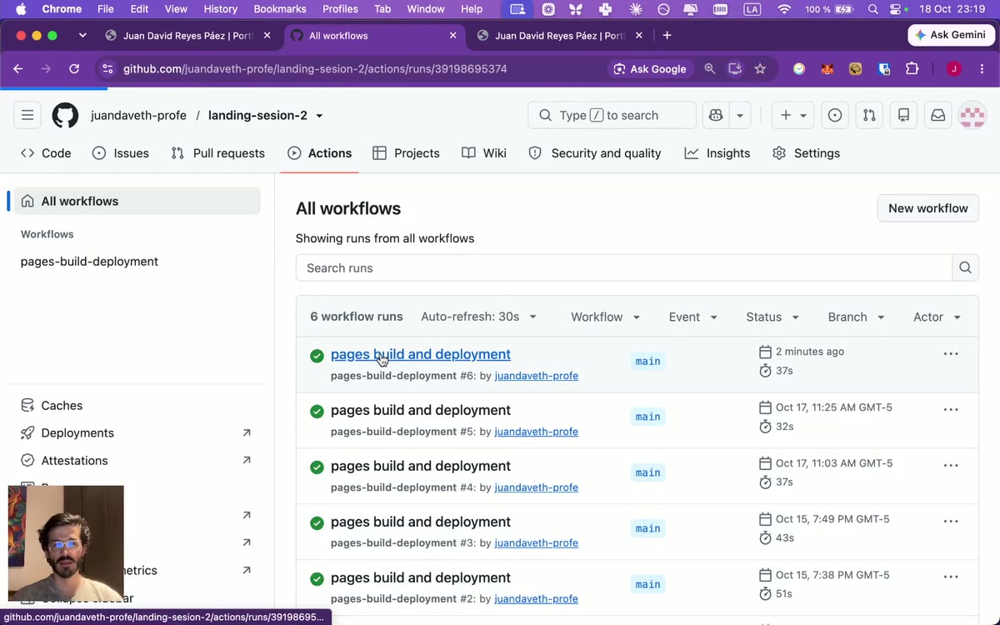

> **Dos caminos, el mismo resultado.** Puedes subir tus cambios con los botones de Source Control (paso 3) o pidiéndoselo al agente. Al principio usa los botones, para ver qué pasa. Después, deja que el agente haga el trabajo.

---

<a id="taller"></a>

## 🛠 Taller para la sesión 3

1. **Haz dos cambios más con el agente** y súbelos a producción. Usa [The Component Gallery](https://component.gallery) para nombrar lo que quieres cambiar.
2. **Mira tu historial.** En GitHub, abre tu repositorio y haz clic en **Commits**: ahí está cada cambio, con su mensaje y su fecha. Es tu libro a muchas manos.
3. **Llega a la sesión 3 con tu carpeta abierta en Antigravity**, conectada a GitHub. Desde ahí le agregamos el formulario y la base de datos.

---

<a id="problemas"></a>

## Problemas frecuentes

| Lo que pasa | Qué hacer |
|---|---|
| No aparece **Go Live** | Revisa que Live Server esté instalado y que tengas abierto un archivo `.html`. Si sigue sin salir, reinicia Antigravity. |
| La dirección empieza por `file://` | Abriste el archivo con doble clic. Ciérrala y usa **Go Live**: la dirección debe empezar por `http://127.0.0.1`. |
| No aparece **Clone Repository** | Revisa que Git esté instalado: en una terminal, `git --version`. Si no responde, instálalo y reinicia Antigravity. |
| El commit falla con *"Please tell me who you are"* | Git no sabe tu nombre. Pídele al agente que lo configure con tu nombre y correo de GitHub. |
| El push pide usuario y contraseña en la terminal | Usa los botones de **Source Control**: escribe el mensaje, **Commit** y después **Sync Changes**. Autoriza GitHub en el navegador. |
| Funciona en mi computador pero no en la página publicada | Faltó el push, o Actions no ha terminado. Revisa que el commit esté en GitHub. |

<a id="glosario"></a>

## Glosario

Los términos de la sesión 1 están en su [glosario](../01/#glosario).

| Término | Qué es |
|---|---|
| **Clonar** | Bajar una copia de tu repositorio a tu computador, que queda conectada con GitHub. |
| **Git** | El programa que lleva el historial de tu proyecto en tu computador y lo sincroniza con GitHub. |
| **Live Server** | Extensión que pone tu página a correr en tu computador, con todos sus archivos, y la refresca cada vez que guardas. |
| **Push** | Mandar tus commits de tu computador a GitHub. |
| **Source Control** | La vista de Antigravity (el ícono de ramitas) que muestra qué archivos cambiaron. **M** = modificado. |
| **Terminal** | La ventana donde se escriben comandos, como `git --version`. |

---

[↑ Volver al contenido](#contenido) · [← Volver al inicio](../../)
